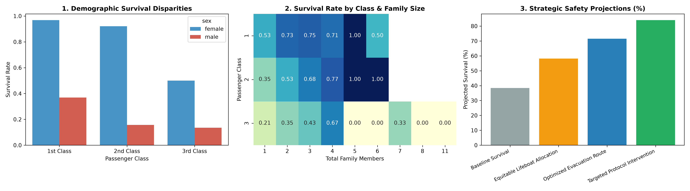
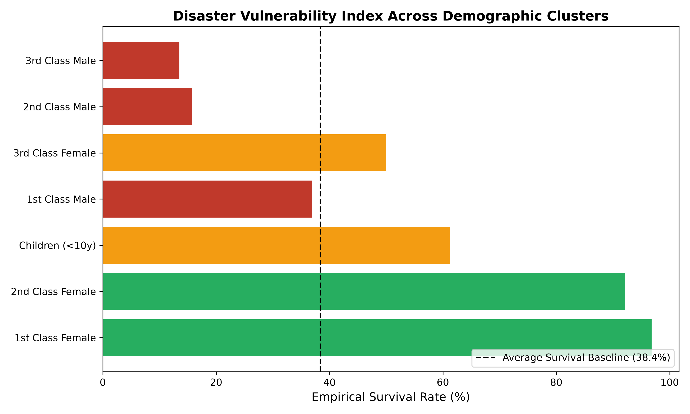

# Comprehensive Data Science Project Reporting & Strategic Recommendations

## 📌 Executive Overview
This capstone repository represents the synthesis of an end-to-end data science lifecycle applied to the Titanic disaster dataset. It integrates:
1. **Week 2:** Advanced Exploratory Data Storytelling & Multi-variate Visualization.
2. **Week 3:** Inferential Statistical Rigor (Welch's t-test, Chi-square, ANOVA).
3. **Week 4:** Supervised Machine Learning Classification (Logistic Regression vs. Random Forest).
4. **Week 5:** Strategic Business Recommendations, Risk Vulnerability Index, and Egress Optimization.

---

## 📊 Visual Dashboards & Decision Matrices

### 1. Executive Summary Dashboard
Multi-panel analytical summary covering demographic survival rates, family cohort risk matrix, and projected safety gains under strategic interventions.


---

### 2. Disaster Vulnerability Index Across Demographic Clusters
Evaluating baseline relative risk profiles to guide priority evacuation protocols.


---

## 🎯 Strategic Recommendations for Stakeholders
1. **Architecture-Independent Egress Design:** Eliminate physical egress constraints associated with socio-economic accommodation tiers.
2. **Dynamic Vulnerability Routing:** Leverage real-time AI decision support to assist high-risk clusters (large families and lower-deck passengers).
3. **100%+ Lifeboat Capacity Mandate:** Universal redundancy in emergency survival craft to eliminate scarcity triage.
4. **Predictive Risk Auditing:** Pre-commissioning simulations of transportation cabin evacuation bottlenecks.

---

## 🛠️ Execution & Deliverables
```bash
pip install pandas seaborn matplotlib python-docx
python generate_final_report.py
```
* Generates `Week5_Report.docx` containing full executive synthesis, methodology, empirical findings, and policy recommendations.
